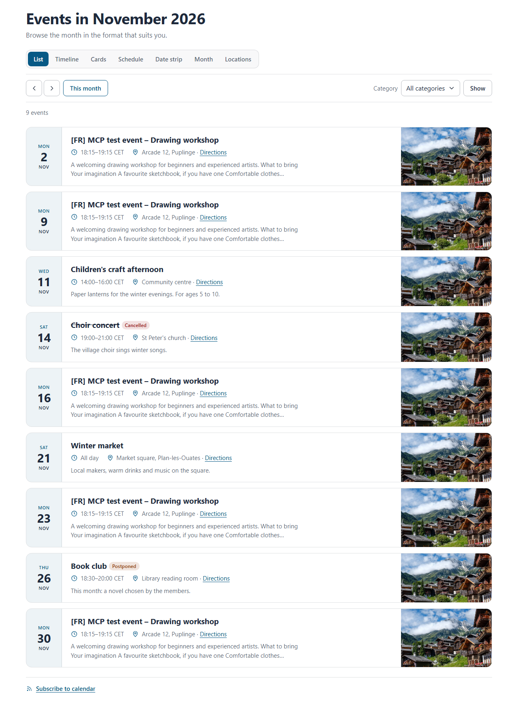
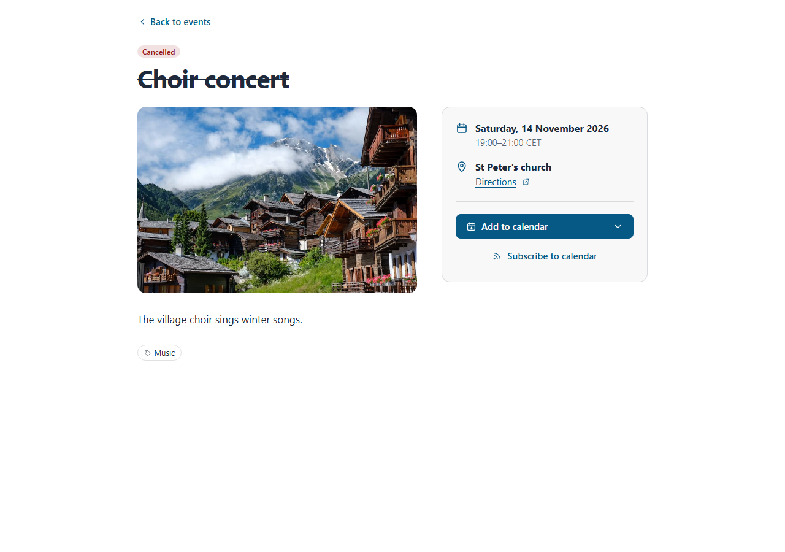

<p align="center">
  
</p>

# Eventual RSVP – Core

<p align="center">
  <a href="https://github.com/Vermeulen-Solutions/eventual-rsvp-core/actions/workflows/ci.yml"></a>
  <a href="https://www.npmjs.com/package/@vermeulen.solutions/eventual"></a>
  <a href="https://plugins.emdashcms.com/plugins/@vermeulen.solutions/eventual"></a>
  <a href="https://emdashcms.com"></a>
  <a href="./LICENSE"></a>
  
  
</p>

**Website:** [eventual.rsvp](https://eventual.rsvp/): documentation, install guide and support for Eventual RSVP – Core, Registrations and Tickets.

Plan and publish events in [EmDash CMS](https://emdashcms.com). Write announcements, choose venues and organizers, set repeat schedules, and share events through your website and calendar subscriptions.

**Current release: 0.19.2**, the same version on the EmDash Registry and on npm. Events are edited in EmDash's own collections, with rich text, images, drafts and translations. Your site builder adds the visitor pages from the package; the screenshots below show them.

In 0.14.x, old events stored inside the plugin are shown only when an administrator explicitly enables **Show old events saved inside the plugin**. Native collections remain authoritative. See [what changed](./docs/release-notes-0.14.0.md).

---

## At a Glance

- **Announcements and images:** use EmDash's normal editor, save drafts, then publish.
- **Flexible schedules:** one-off, daily, weekly or monthly events, with changes to individual dates.
- **Saved venues and organizers:** choose existing entries instead of retyping them.
- **Languages:** separate announcements per language, with shared published schedules. The admin speaks 21 languages, including Arabic and Hebrew right to left.
- **Calendars:** event downloads and iCalendar subscriptions.
- **Website integration:** JSON feeds, optional Astro helpers and seven example layouts.
- **Sandboxed:** declared permissions; the only outbound host is `cdn.jsdelivr.net`, for the admin's language packs, each checked against a hash built into the release.

## Get Started

1. An administrator [installs Eventual RSVP and connects the collections](./docs/collection-setup.md).
2. Editors follow [Managing events](./docs/user-guide.md): save an announcement, open **Dates, venue & repeat**, then publish.
3. Site builders use the [developer guide](./docs/developer-guide.md) to connect visitor pages.

For the opt-in HTML cache integration, see [public feed caching](./docs/public-feed-caching.md). Eventual RSVP does not enable site caching.

Requires **EmDash >=1.2.0 <2.0.0**; tested on 1.2.0, 1.4.0, 1.5.0 and 1.6.0. **1.4.0 or newer is recommended** because it fixes nested Block Kit forms and Cloudflare plugin mutations; 1.2/1.3 remain supported with those host limitations. Newer EmDash releases that have not been tested yet are not refused: the source installer prints a warning, and if the editor adapters no longer match a newer admin build they step aside and EmDash's own editor is used. Upgrades from 0.12.x or earlier need the [native-content upgrade](./docs/upgrade-0.13.0.md). Source/developer tooling needs Node 24+.

---

## Visual Tour

### 1. Website Calendar
Show events on your site with two ready-made Astro pages from the package: an events page with seven views (list, timeline, cards, schedule, date strip, month and locations), month navigation and a category filter, and an event page with calendar buttons. They come in 21 languages, in light and dark, and without client-side JavaScript; see [Event pages](./docs/developer-guide.md#event-pages).

<p align="center">
  
</p>

---

### 2. Event Details & One-Click Calendar Sync
Visitors can view full event details, join virtual meetings, get venue directions, and add events to Google Calendar, Outlook, Office 365 or any calendar app (iCal file).

<p align="center">
  
</p>

---

### 3. Native Event Editor
Write announcements in EmDash's rich-text editor. Save the draft, then open Dates, venue & repeat for local dates, recurrence and individual-date changes. The Eventual RSVP workspace links to the selected content types and offers safe draft duplication.

<p align="center">
  
</p>

---

### 4. Saved Organizers & Venues
Maintain a directory of organizers (names, websites, contact links) and physical venues with structured addresses and map directions.

Venue choices combine translation siblings into one selection, show the name and address, and retain the saved native ID. The schedule panel searches native names and addresses, including accents. Unpublished dependencies are marked and must be published before their events. Create and edit links open the native venue editor.

---

## Optional Website Views

Visitors can switch between seven viewing formats via query parameter (e.g., `/events?view=month`):

| View | Query Param | Description |
| :--- | :--- | :--- |
| **List** *(Default)* | `?view=list` | Chronological agenda list with high-contrast date blocks. |
| **Timeline** | `?view=timeline` | Vertical timeline with visual event nodes and summary cards. |
| **Card Grid** | `?view=cards` | Rich card grid displaying event cover images, organizers, and tags. |
| **Daily Schedule** | `?view=schedule` | Collapsible daily disclosures grouping events per date. |
| **Date Strip** | `?view=dates` | Horizontal date jump bar for quick navigation across the month. |
| **Month Calendar** | `?view=month` | Full week-aligned calendar grid on desktop; day-by-day agenda on mobile. |
| **Locations** | `?view=locations` | Events grouped by physical venue or virtual attendance with map directions. |

---

## For Developers

Eventual RSVP's Registry package supplies the sandbox backend and editor controls. Optional Astro, schema and transfer helpers are on npm as [`@vermeulen.solutions/eventual`](https://www.npmjs.com/package/@vermeulen.solutions/eventual):

```sh
npm install @vermeulen.solutions/eventual
```

Keep its version the same as the Registry backend. **Do not run `npm install eventual`:** the unscoped name is an unrelated package by another author.

Use the **installed plugin ID** in API URLs and MCP tool names. A config-managed site uses `eventual`; a Registry install gets a generated ID that starts with `r_`. The **Subscribe** links on the Eventual RSVP admin page show it. Pass it as `pluginId` to `fetchPublicFeed`, and to the event page loaders. Install the backend one way only, from the Registry or from the config: the [developer guide](./docs/developer-guide.md#installation-and-plugin-id) explains what goes wrong otherwise, and [what to do before moving a site to the Registry](./docs/developer-guide.md#moving-a-site-from-the-config-to-the-registry).

The [developer guide](./docs/developer-guide.md) covers public JSON/ICS/image routes, SSR dispatch, tool names, settings, transfer formats, permissions and sandbox limits. It also explains installing the matching npm helpers. Eventual RSVP's MCP tools inspect native data; native edits and publication use EmDash's core tools.

For source changes:

```sh
npm ci
npm run validate
npm run typecheck
npm test
npm run build
npm run bundle
npm run budget
```

The backend shares EmDash's sandbox call budget: the public feeds use up to 30 calls per request, everything else 10. Large feeds and migrations need host-specific verification; optional public URL lookups can be disabled when your site constructs its own links. [Details and checks](./docs/developer-guide.md#limits-and-checks).

---

## Documentation

- [Managing events](./docs/user-guide.md) — the editor's everyday guide.
- [Install and connect](./docs/collection-setup.md) — administrators and schema setup.
- [Upgrade and migrate](./docs/upgrade-0.13.0.md) — existing sites and old plugin data.
- [Developer guide](./docs/developer-guide.md) — integration and API reference.
- [Changelog](./CHANGELOG.md) · [0.19.0 release notes](./docs/release-notes-0.19.0.md) · [0.18.7 release notes](./docs/release-notes-0.18.7.md) · [0.18.6 release notes](./docs/release-notes-0.18.6.md) · [0.18.5 release notes](./docs/release-notes-0.18.5.md) · [0.15.0 cache integration](./docs/release-notes-0.15.0.md) · [0.14.0 native collections](./docs/release-notes-0.14.0.md).
- [Astro example site](./examples/astro-events/README.md) — the event pages in a small site.
- [Release evidence and older records](./docs/history.md).

---

## License

Eventual RSVP is licensed under the [MIT License](./LICENSE).
